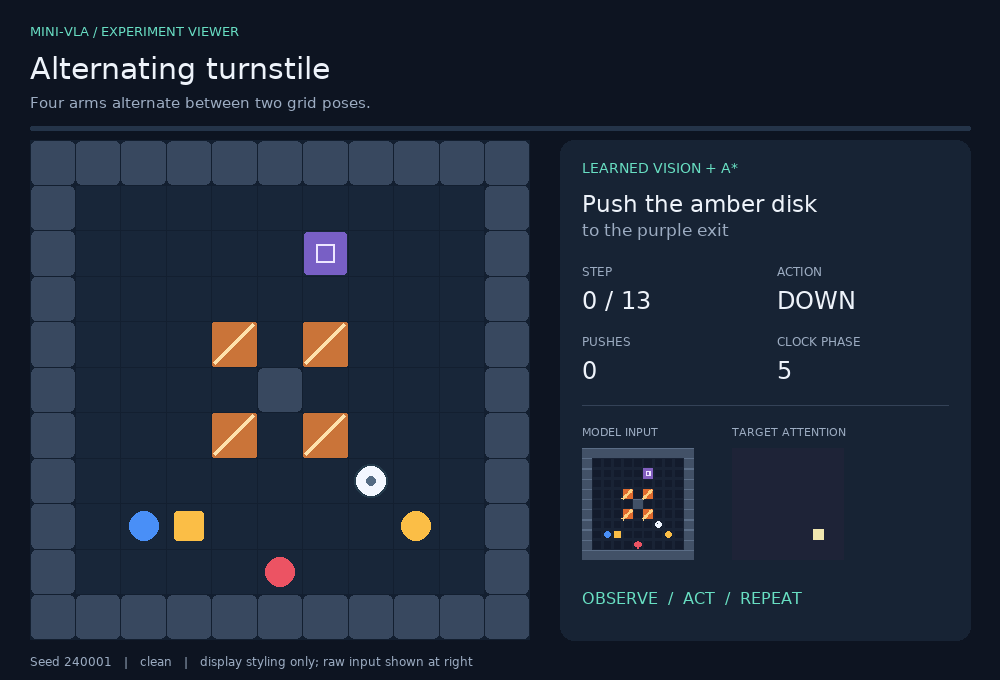
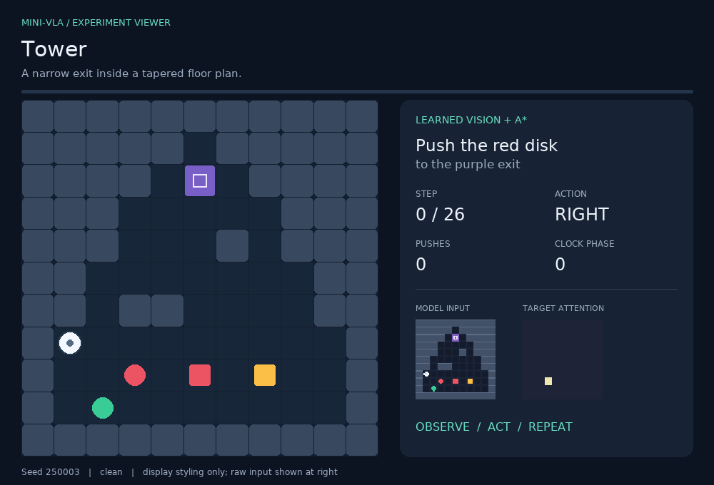
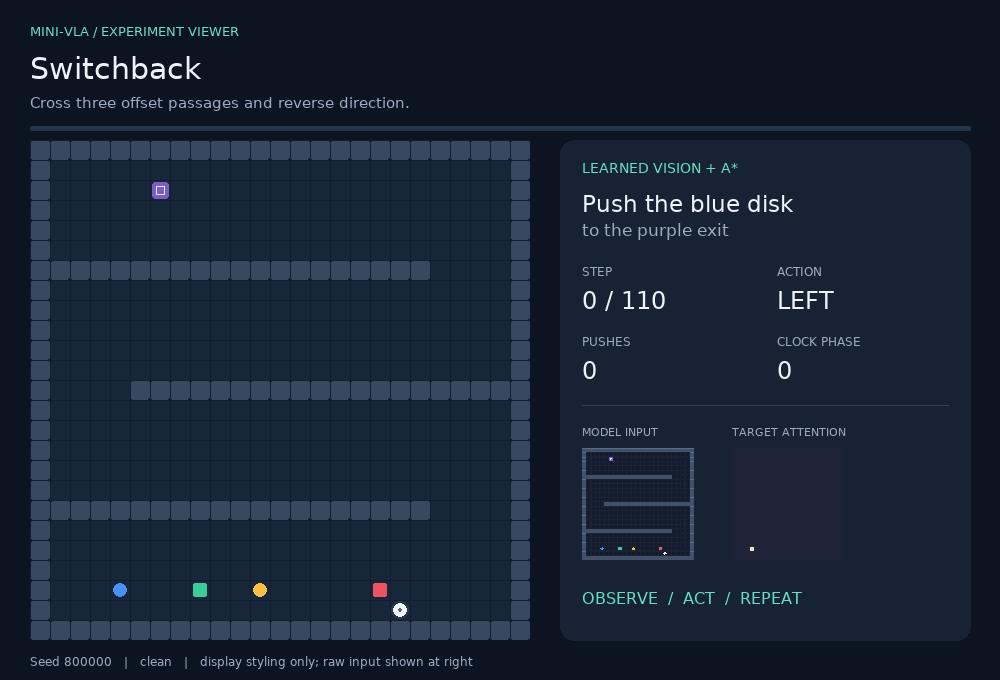

# Recorded runs

These GIFs are ordered to show how the experiment develops: first direct action prediction, then a learned map with explicit planning, and finally larger timed mazes. Each animation shows the instruction and controller. In the viewer, the raw RGB frame received by the model appears alongside the display view.

Open [`gallery.html`](gallery.html) in a browser for a single-run viewer with episode counts and controls.

## 1. Direct action prediction

The neural policy predicts the next move. It can succeed on a particular seed, but small action errors compound over an episode.

## 2. Learned perception with A* planning

The hybrid uses the network's target and semantic map, then A* searches under known simulator rules. Waiting at a gate and navigating unseen layouts are handled by the planner; these routes are not generated by the neural action head.

## 3. Larger 25×25 mazes

The convolutional visual heads are reused on larger maps. The fixed-size action head is not evaluated; A* supplies the route.

## 4. Three airlocks

The final run passes three timed gates in sequence: 76 actions, 59 pushes, two waits, no collisions.

## Earlier continuous-action baseline

This is a separate experiment with continuous horizontal actions; it is not the maze policy or an ablation of the maze model.

## Selection and scores

Benchmark animations use the first matching episode in the recorded test order. Counterfactual illustrations in `media/counterfactual_*.gif` use a separate seed set and are excluded from benchmark scores. Per-episode data and exact counts are in [`results/maze/episodes.csv`](results/maze/episodes.csv) and [`results/large/episodes.csv`](results/large/episodes.csv); the aggregate results and confidence intervals are in [`RESULTS.md`](RESULTS.md).
