# Experiment viewer

Open [gallery.html](gallery.html) in a browser to switch between runs. The selection includes successes, a neural-policy failure, and all three larger arenas. Every animation labels its controller and displays the raw model input beside the styled view.

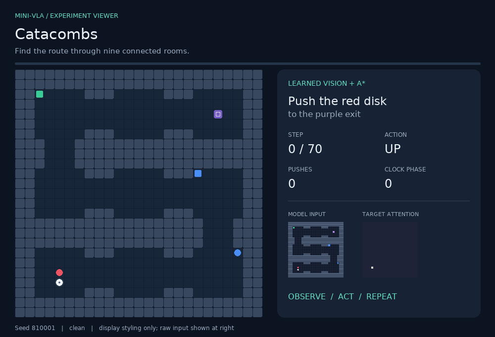

The new viewer uses the first accepted test scene for each large arena. The earlier diagnostic gallery below preserves its original selection rule.

# Behaviour gallery

Every animation identifies the controller, instruction, seed and outcome. Success and failure examples use the **first matching episode** in the declared test order. Counterfactual illustrations use a separate seed set and are excluded from benchmark scores.

## Continuous action baseline

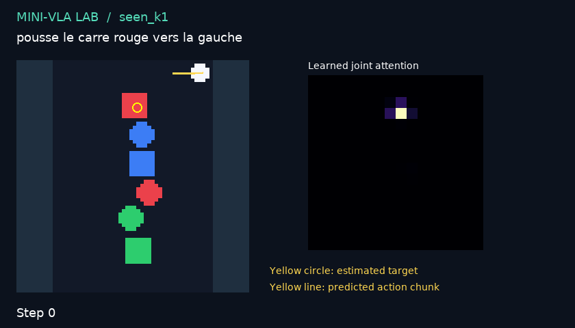

*The baseline predicts continuous action chunks directly; it has no route planner.*

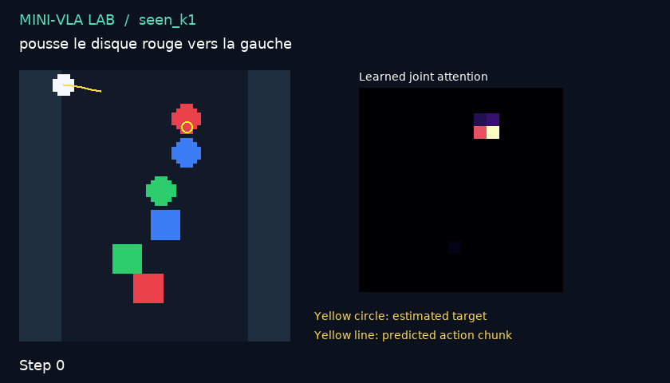

## Maze controllers

### baffles — direct — success

Instruction: `push the green disk to the exit`. Seed: 210009. 18 steps, 12 pushes, 0 waits, 0 blocked moves.

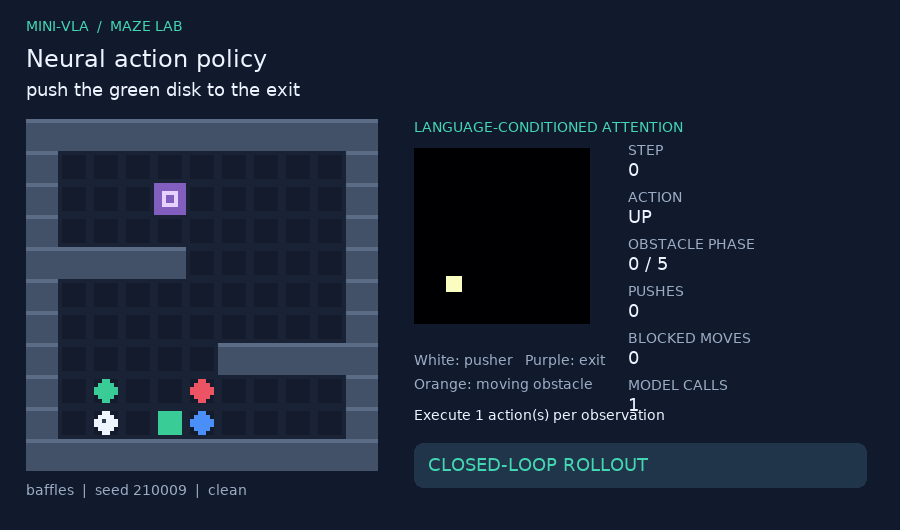

### baffles — direct — timeout

Instruction: `push the amber disk to the exit`. Seed: 210016. 100 steps, 3 pushes, 0 waits, 96 blocked moves.

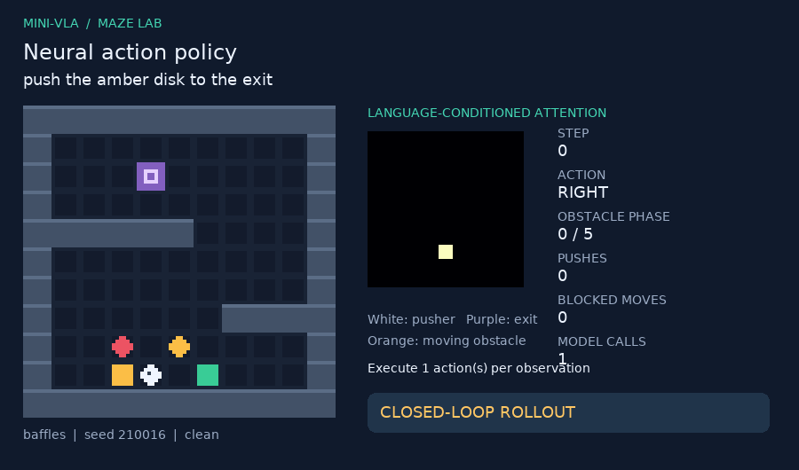

### baffles — direct — distractor_contact

Instruction: `push the green square to the exit`. Seed: 210007. 2 steps, 0 pushes, 0 waits, 1 blocked moves.

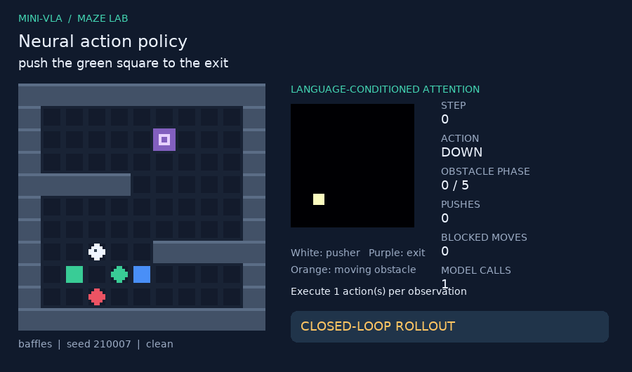

### gate — direct — success

Instruction: `push the green square to the exit`. Seed: 220010. 18 steps, 10 pushes, 0 waits, 0 blocked moves.

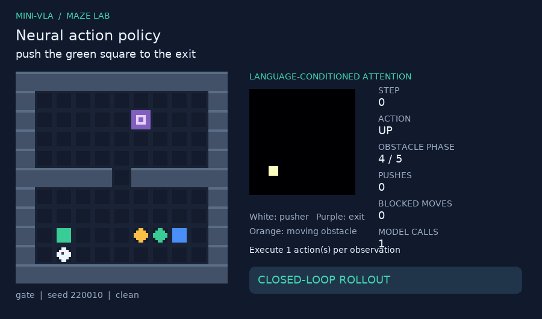

### gate — direct — timeout

Instruction: `push the green square to the exit`. Seed: 220001. 100 steps, 0 pushes, 0 waits, 0 blocked moves.

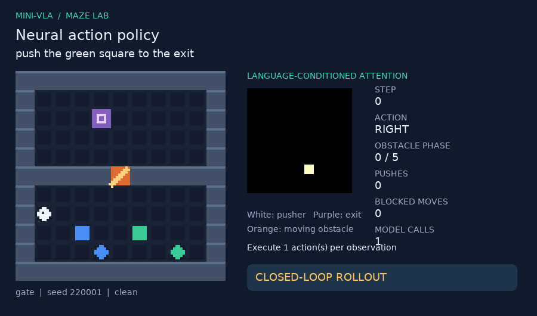

### gate — direct — distractor_contact

Instruction: `push the red square to the exit`. Seed: 220004. 5 steps, 0 pushes, 0 waits, 1 blocked moves.

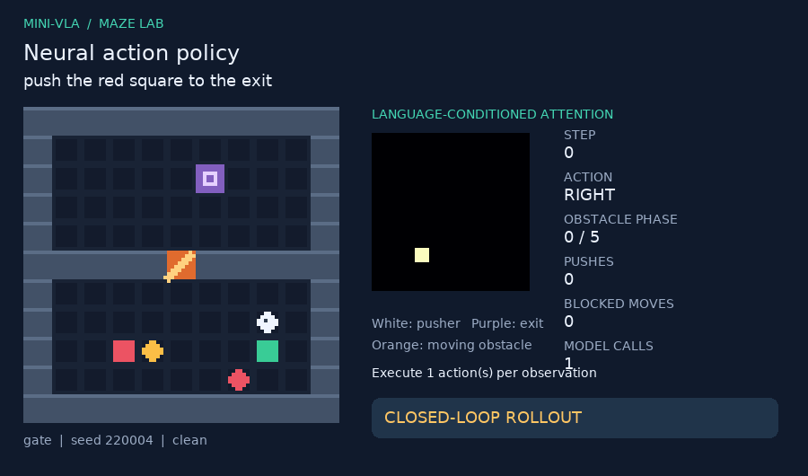

### gate — hybrid — success

Instruction: `push the green square to the exit`. Seed: 220001. 22 steps, 8 pushes, 1 waits, 0 blocked moves.

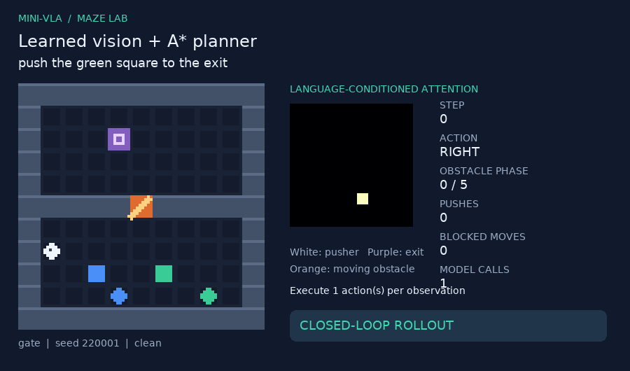

### sweeper — hybrid — success

Instruction: `push the green disk to the exit`. Seed: 230003. 19 steps, 10 pushes, 0 waits, 0 blocked moves.

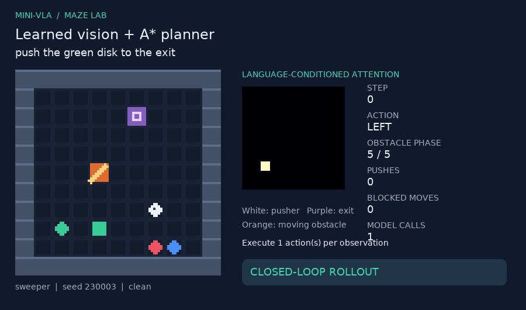

### rotor — hybrid — success

Instruction: `push the amber disk to the exit`. Seed: 240001. 13 steps, 8 pushes, 0 waits, 0 blocked moves.

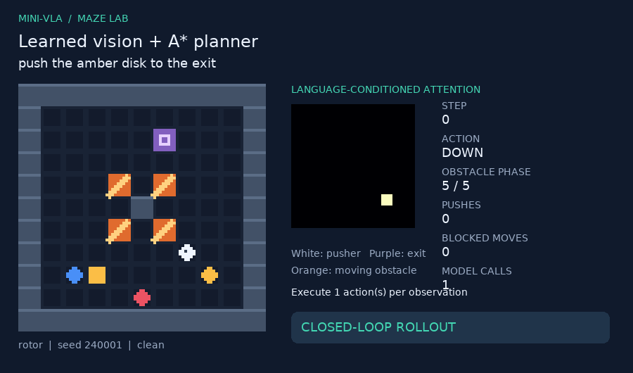

### tower — hybrid — success

Instruction: `push the red disk to the exit`. Seed: 250003. 26 steps, 10 pushes, 0 waits, 0 blocked moves.

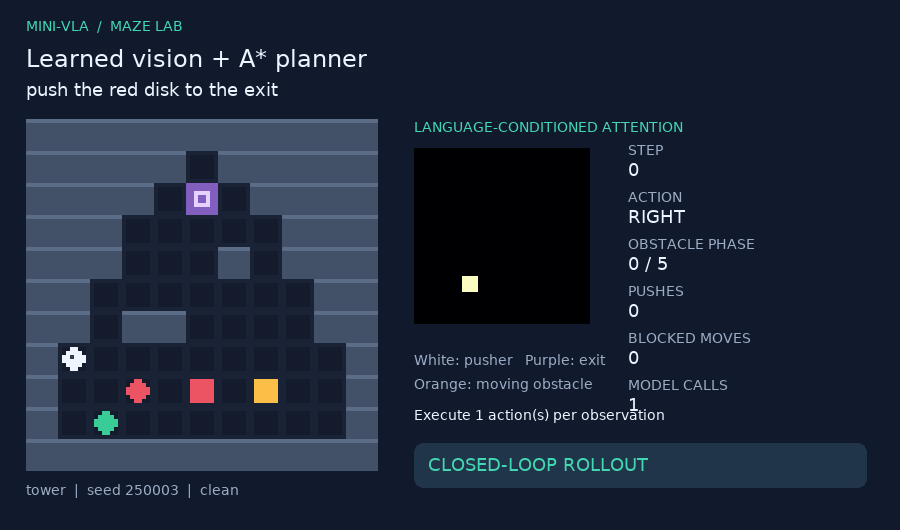

### baffles — hybrid — success

Instruction: `push the blue disk to the exit`. Seed: 260004. 16 steps, 8 pushes, 0 waits, 0 blocked moves.

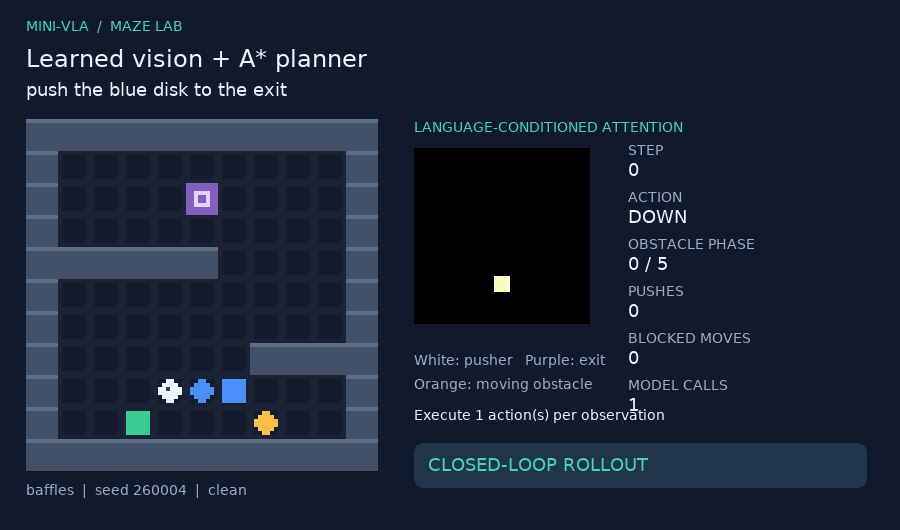

### baffles — hybrid — success

Instruction: `push the red square to the exit`. Seed: 400002. 14 steps, 8 pushes, 0 waits, 0 blocked moves.

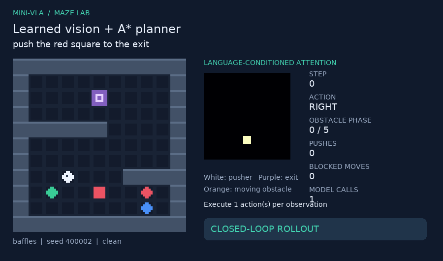

### baffles — hybrid — success

Instruction: `push the green disk to the exit`. Seed: 400002. 20 steps, 11 pushes, 0 waits, 0 blocked moves.

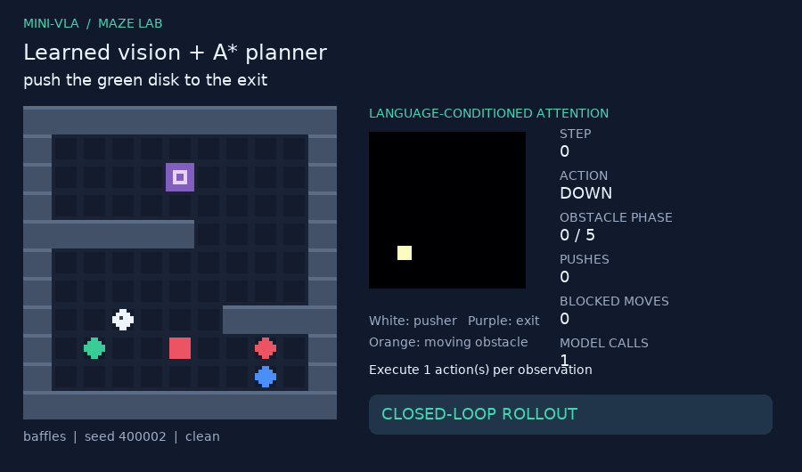
