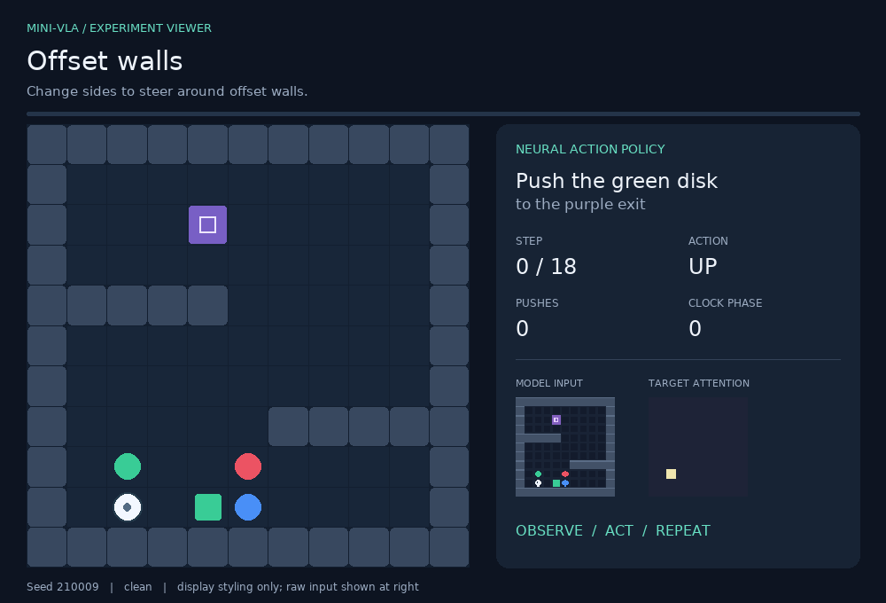
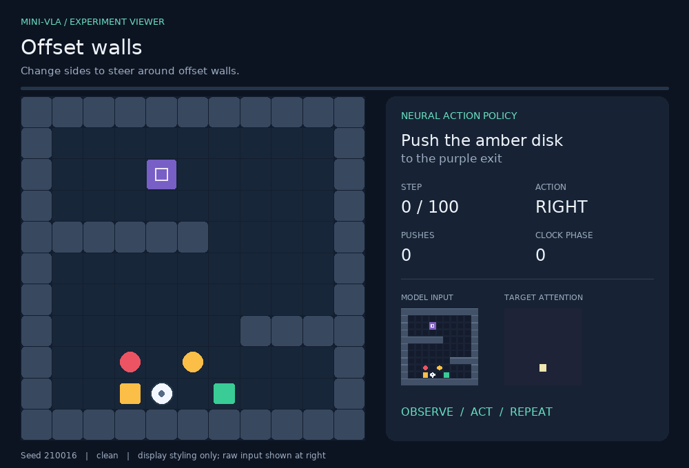
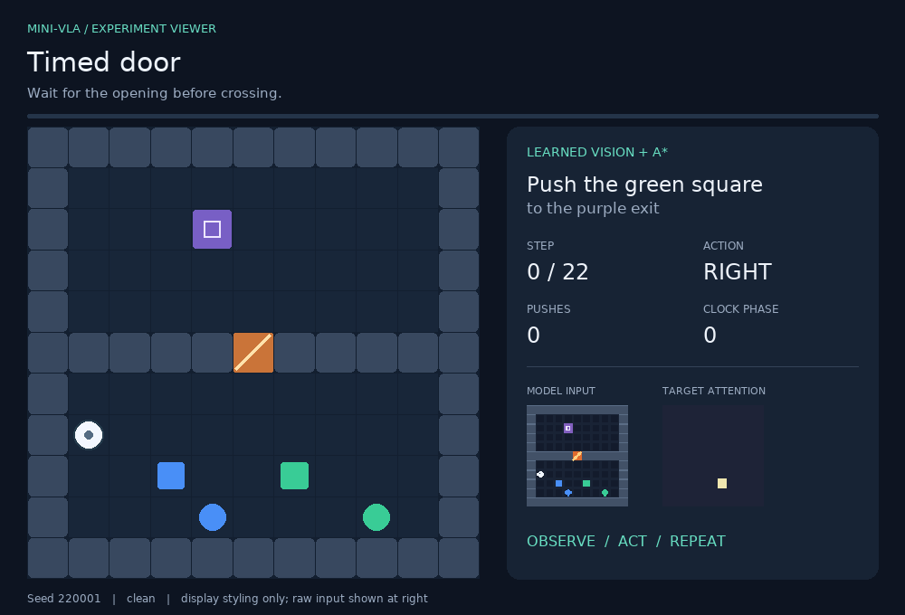

# Mini-VLA Maze

**A small vision-language-action model for pushing a requested object through a maze.** Give it an image and an instruction such as “push the green disk to the exit”; it must identify the right object and move it without hitting the others.

This is a compact, inspectable VLA-style experiment, not a general-purpose robot model. It uses a fixed instruction grammar and a 2D simulator, so the language and dynamics are deliberately constrained.

## The experiment, step by step

### 1. Predict the next move

The direct policy sees the scene and instruction, then predicts one of five moves. It can solve some simple layouts:



But a good-looking episode hides how brittle the policy is. On the same 16-scene-per-suite benchmark, it completes only **19 of 112** episodes with one-step actions. Here is a representative timeout:



### 2. Predict a short action chunk

The model can also predict four moves at once. That means fewer chances to query the network, but the robot cannot correct an early mistake until the chunk ends. In this run, chunking lowered success to **11/112**. The learning curves show why: validation action accuracy reaches 86.9%, leaving errors that can accumulate during a long push.


### 3. Use the learned scene map to plan

The network also predicts the target location and a semantic map of the grid. A separate A* planner can use that map and the simulator’s known movement rules to find a complete route. This hybrid completed **112/112** accepted small-maze scenes. The gain comes from explicit search, not from a better action head.



The benchmark below compares direct one-step actions, four-action chunks, the learned-map + A* system, and an oracle with ground-truth state. Each scene has 16 accepted, solvable episodes; whiskers show 95% Wilson intervals. The two starred layouts were held out during training.


### 4. Reuse visual perception on larger maps

On 25×25 maps, the convolutional visual heads still produce a semantic grid. The fixed-size action head is not used; A* plans with the same known simulator rules. All **18/18** accepted episodes succeeded across switchback, catacombs and airlocks. These are small, solvable test sets—not evidence of general robot control.


### 5. Three airlocks

The final scene puts three timed gates in one route. The recorded run takes **76 actions**, including **59 pushes and two waits**, with no collisions. The model reads the scene; the planner computes this route.


## Why this counts as a VLA-style model

The model connects all three parts of the term:

| Part | Input or output in this project |
|---|---|
| **Vision** | An 88×88 RGB image, divided into an 11×11 grid of visual features. |
| **Language** | A short instruction parsed into colour and shape IDs, then represented by learned embeddings. It is a fixed grammar, not a general text encoder. |
| **Action** | Five discrete actions—up, right, down, left or wait—predicted as a four-step chunk. |

It also predicts a target-attention map and per-cell semantic labels. The obstacle phase is supplied as a small simulator state input. The hybrid controller passes the learned target and map to A*; A* uses programmed movement and obstacle rules. It does not use the neural action prediction to produce the displayed route.


The network has 401,729 parameters and learns from synthetic expert demonstrations. It has no pretrained language model, no transformer decoder and no reinforcement-learning objective. [Methods and protocol](docs/METHODS.md) explain the implementation and evaluation; [RESULTS.md](RESULTS.md) includes stress tests, uncertainty and failure analysis.

## Run it

Python 3.10+; CPU is enough. From this folder:

```bash
python -m pip install -e .
python -m unittest discover -s tests -v
python -m mini_vla_maze.demo --kind gate --controller hybrid
```

The checkpoint and recorded episodes are included. Open [`gallery.html`](gallery.html) locally to browse the GIFs in order; [GALLERY.md](GALLERY.md) lists every demonstration. You can also start with [notebook 02](notebooks/02_maze_lab.ipynb). [Reproduction steps](docs/REPRODUCE.md) cover training and Colab validation.
