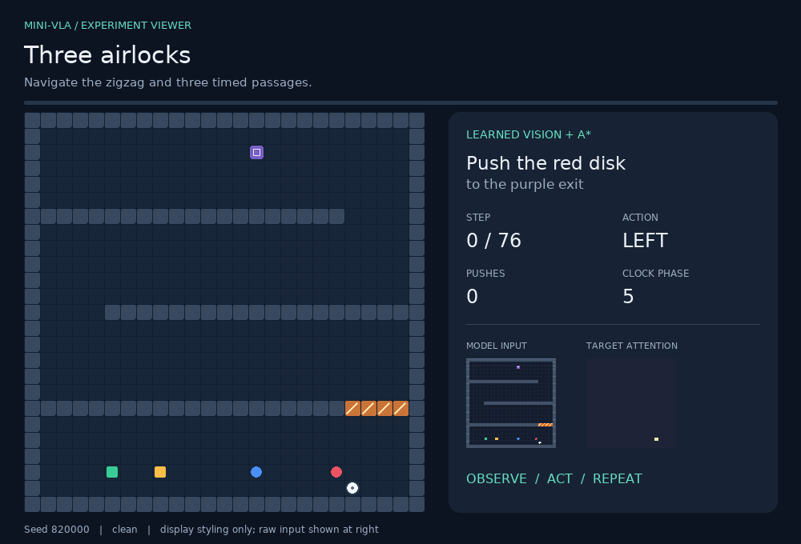
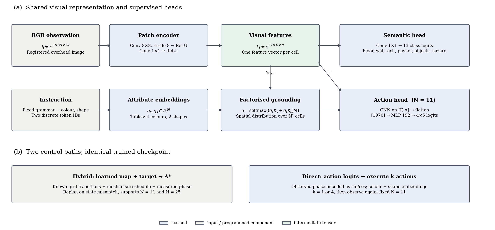

# Mini-VLA Maze

Push the requested object to the exit, without touching the other objects.

This project starts with a small imitation-learning policy and asks what happens when a pushing task needs more than a few correct moves. The model learns visual grounding and action chunks from synthetic demonstrations. A second controller uses its learned scene representation with A*.



*Three airlocks, 76 actions, 59 pushes, two waits. This is learned perception + A*: the neural action head does not produce this route.*

**[Experiment viewer](gallery.html)** · **[Results](RESULTS.md)** · **[Methods](docs/METHODS.md)** · **[Environment guide](docs/ENVIRONMENTS.md)**

## The experiment

The network has 401,729 parameters and uses a fixed colour/shape grammar. The 11×11 tasks compare direct action prediction with explicit planning on a predicted semantic map. The 25×25 extension reuses the visual heads, leaving the fixed-size action head out of the loop.



[Vector figure](media/paper_architecture.svg) · [PDF figure](media/paper_architecture.pdf)

## What worked, and what did not

| Evaluation | Direct policy, k=1 | Learned vision + A* |
|---|---:|---:|
| Seven 11×11 suites, 112 accepted scenes | 19/112 | 112/112 |
| Three 25×25 arenas, 18 accepted scenes | Not applicable | 18/18 |
| Strong camera darkening, 16 small scenes | 3/16 | 2/16 |

The direct model predicts the expert's next action correctly on 86.9% of validation observations, yet often fails an entire episode. Accurate grounding is not enough to steer an object through a sequence of turns. The hybrid addresses this with search, but fails when its visual map is wrong.


These are small, oracle-solvable test sets and one training seed. The large-map experiment keeps the same tile appearance, camera registration and known dynamics. It is a constrained size-transfer test, not evidence of general robot control. [Results and confidence intervals](RESULTS.md).

## Run

Python 3.10 or later; CPU is sufficient. From the extracted folder:

```bash
python -m pip install -e .
python -m unittest discover -s tests -v
python -m mini_vla_maze.demo --kind gate --controller hybrid
```

The checkpoint is included. No external dataset, model-hub account or API key is needed. Open `gallery.html` in a browser to inspect saved runs without installing Python.

```bash
python -m mini_vla_maze.large --checkpoint results/maze/weights.pt --out runs/large --episodes 6
```

For training and figure generation, see [reproduction commands](docs/REPRODUCE.md).

## Notebooks and records

- [01 — Continuous pushing](notebooks/01_continuous_baseline.ipynb): the original continuous-action experiment.
- [02 — Maze lab](notebooks/02_maze_lab.ipynb): inspect, train and compare controllers using the package.
- [03 — Portable validation](notebooks/03_portable_validation.ipynb): source and checkpoint embedded; runs in Colab without a second upload.
- `results/maze/`: local 11×11 reference run and checkpoint.
- `results/large/`: local 25×25 evaluation.
- `results/colab/`: independent CPU execution, provenance and episode records.

Colab reproduced all 692 evaluated episode outcomes and action counts. [Verification details](docs/VALIDATION.md).

The [methods report](docs/METHODS.md) covers the losses, controller inputs, test selection and related research. [Possible applications](docs/APPLICATIONS.md) describe what would need to change for real robotics. Code and generated assets use the [MIT license](LICENSE); [reuse notes](docs/REUSE.md) explain it briefly.
