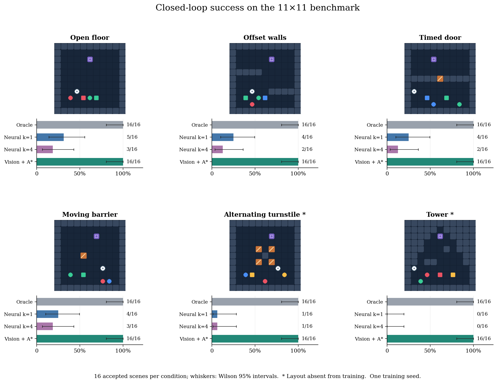
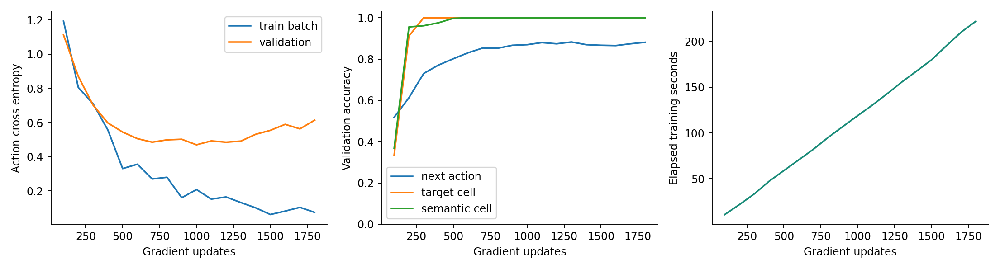
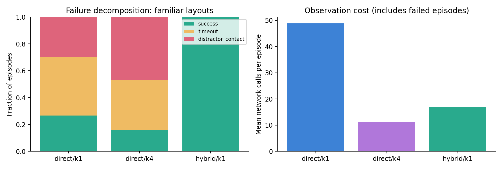
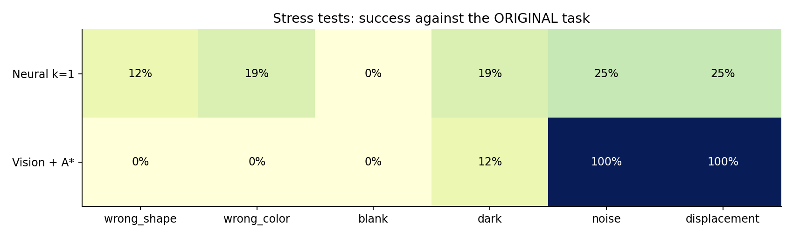
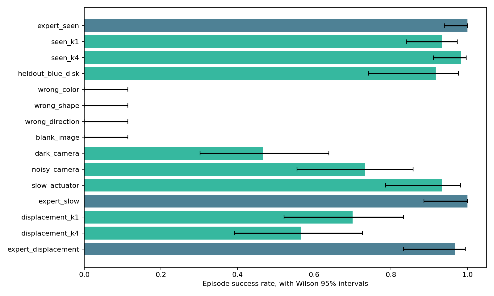
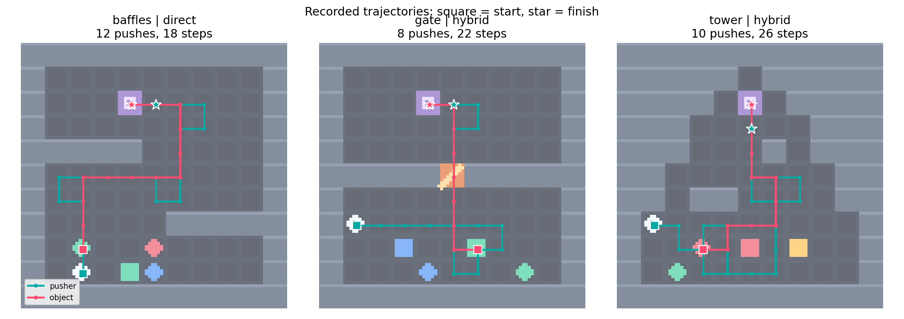
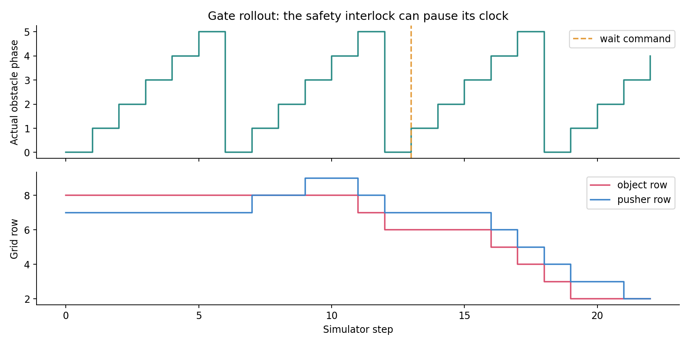

# Results

## Maze experiment

CPU reference run: **401,729 parameters**, 320 training episodes, 5,449 expert observations; 1,800 updates. Selected checkpoint: update **1000**.

Measured data preparation: 12.8 s; training and periodic validation: **222.1 s**. Environment: Python 3.12.0, PyTorch 2.14.1+cpu. These are measurements on the execution host, not guaranteed Lenovo or Colab timings.

| Suite | Oracle | Neural k=1 | Neural k=4 | Learned vision + A* |
|---|---:|---:|---:|---:|
| open | 16/16 | 5/16 | 3/16 | 16/16 |
| baffles | 16/16 | 4/16 | 2/16 | 16/16 |
| gate | 16/16 | 4/16 | 2/16 | 16/16 |
| sweeper | 16/16 | 4/16 | 3/16 | 16/16 |
| unseen_rotor | 16/16 | 1/16 | 1/16 | 16/16 |
| unseen_tower | 16/16 | 0/16 | 0/16 | 16/16 |
| heldout_blue_disk | 16/16 | 1/16 | 0/16 | 16/16 |

## What the experiment shows

The selected checkpoint achieves 100.0% target-cell accuracy and 100.0% semantic-cell accuracy on expert validation observations. Next-action accuracy is 86.9%. Nevertheless, the direct policy often fails whole episodes. Good one-step predictions do not guarantee reliable multi-step manipulation.

The hybrid completes the listed primary test scenes by combining learned perception with exact search under known dynamics. This demonstrates a working perception/planning interface on this renderer; it does not show that the network learned A*, arbitrary maze solving, or real robot control.

The left panel tracks action-prediction loss on training batches and held-out validation frames. The middle panel separates three tasks: choosing the next action, locating the requested object, and classifying each grid cell. Object grounding reaches 100% on this validation split; action accuracy reaches 86.9%. The right panel shows elapsed CPU training time, not model performance.

The left chart breaks familiar-layout outcomes into success, timeout and contact with a protected object. `direct/k1` predicts one move per observation; `direct/k4` predicts a four-action chunk; `hybrid/k1` replans with A* from the learned map. The right chart counts network observations per episode, including episodes that failed. Chunking reduces calls but did not improve success here.

## Stress tests

| Condition | Neural k=1 | Learned vision + A* |
|---|---:|---:|
| wrong_shape | 2/16 | 0/16 |
| wrong_color | 3/16 | 0/16 |
| blank | 0/16 | 0/16 |
| dark | 3/16 | 2/16 |
| noise | 4/16 | 16/16 |
| displacement | 4/16 | 16/16 |

Displacement oracle: 16/16. Wrong-instruction scores use the original task as the success criterion; some direct-policy successes under wrong commands reveal weak instruction dependence in control, despite accurate auxiliary grounding. The positive same-image / different-task examples are in [the gallery](GALLERY.md).

Strong darkening is a major failure mode, including for the hybrid. Its planner cannot repair an incorrect visual map. The clean 16/16 results have a Wilson 95% interval of approximately 81%–100%, not certainty of perfect performance.

## Continuous baseline

The baseline is a separate previously executed CPU experiment, retained without rerunning or merging it with the maze evaluation. Its actions are continuous and primarily horizontal; maze actions are discrete and two-dimensional.

| Condition | Success |
|---|---:|
| seen_k1 | 56/60 |
| seen_k4 | 59/60 |
| heldout_blue_disk | 22/24 |
| dark_camera | 14/30 |
| noisy_camera | 22/30 |
| displacement_k1 | 21/30 |
| displacement_k4 | 17/30 |

## Reproducibility and interpretation

- Raw episode records: [maze CSV](results/maze/episodes.csv), [baseline CSV](results/baseline/episodes.csv).
- Full confidence intervals and costs: [maze metrics](results/maze/metrics.json).
- Checkpoint selection and loss history: [training record](results/maze/training.json).
- Accepted and rejected candidates: [test manifest](results/maze/test_manifest.json).
- GIF selection and controller labels: [gallery manifest](media/gallery_manifest.json).
- One model training seed; no claim of statistical superiority across independently trained models.
- Performance is conditioned on oracle-solvable candidates from a small generator.
- Attribute labels, grid alignment, phase sensor and known hybrid dynamics are strong inductive assumptions.

## Recorded trajectories and timing

The gate timeline shows actual phase, including interlock pauses, alongside object/pusher positions. A successful route may deliberately wait or take a detour.

## Larger 25×25 arenas

The original visual heads are reused without retraining. A* plans the actions; the fixed-size action head is not evaluated here.

| Arena | Hybrid | Oracle | Mean steps | Mean pushes |
|---|---:|---:|---:|---:|
| Switchback | 6/6 | 6/6 | 92.5 | 70.7 |
| Catacombs | 6/6 | 6/6 | 59.0 | 49.3 |
| Three airlocks | 6/6 | 6/6 | 86.2 | 67.3 |

Six successes out of six give a Wilson 95% interval of roughly 61%–100% for each arena. This is a small evaluation, conditioned on solvability. The longest recorded switchback example uses 110 actions and 82 pushes.

See [the environment guide](docs/ENVIRONMENTS.md) for pictures and [the experiment viewer](gallery.html) for animations. [Large-scene episode CSV](results/large/episodes.csv).

## Independent Colab execution

The supplied checkpoint was evaluated on a Google Colab CPU runtime (Python 3.13.16, PyTorch 2.11.0+cpu). The reference benchmark took about 45 seconds and the large-arena cell about 25 seconds according to the notebook UI. These are evaluation timings, not training times.

All 656 small-scene and 36 large-scene controller episodes match the corresponding local outcome and action-count records. Timing columns differ. Both runs use the same checkpoint hash.

Files: [runtime provenance](results/colab/provenance.json), [small-scene CSV](results/colab/small/episodes.csv), [large-scene CSV](results/colab/large/episodes.csv), [execution capture](results/colab/execution.png).
