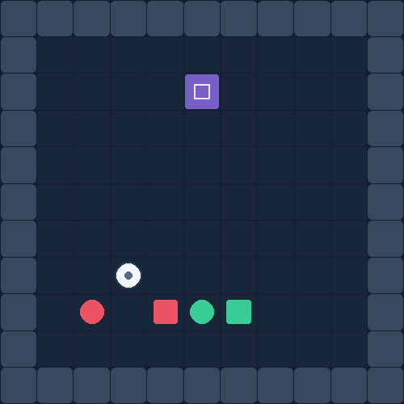
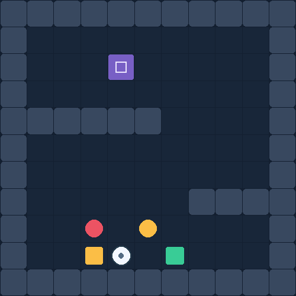
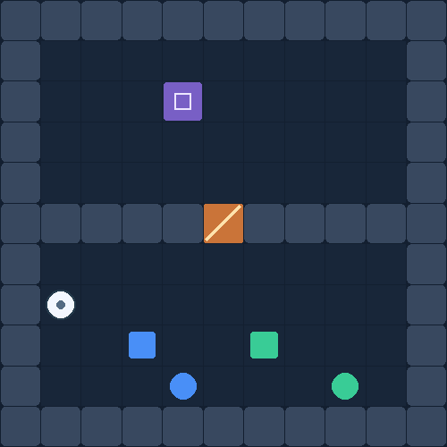
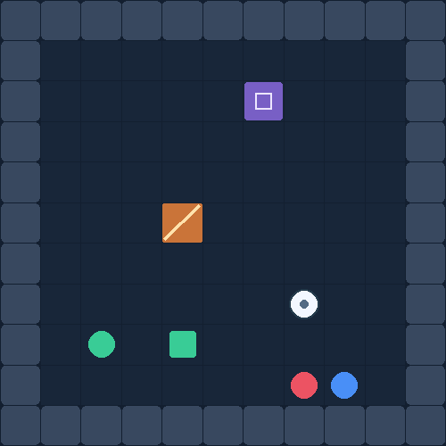
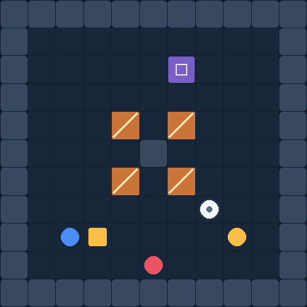
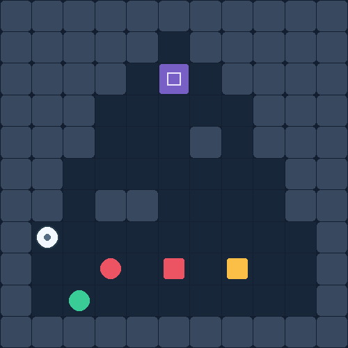
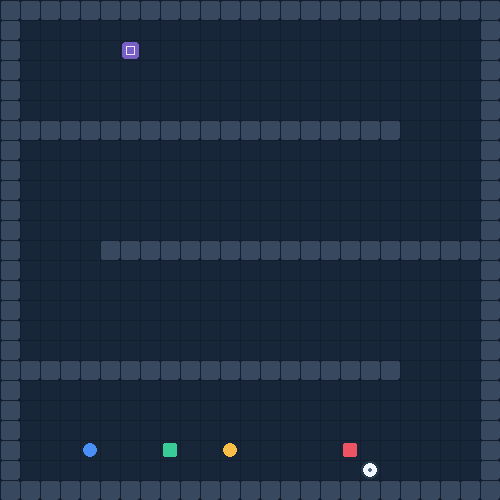
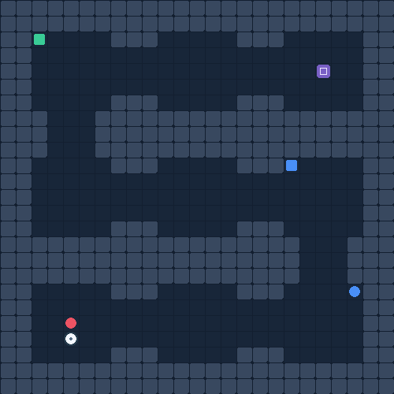
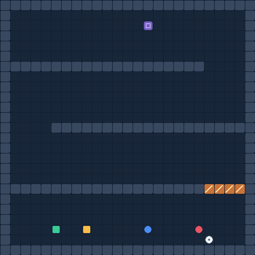

# Environments

The English labels in the figures correspond to the explanations below. White is the pusher; purple is the exit; orange marks an active mechanism.

## Open floor — Sol libre

Select the object and approach its pushing side.

## Offset walls — Chicanes

Go around staggered walls and change pushing side.

## Timed door — Porte temporisée

Wait for a passage to open.

## Moving barrier — Barrière mobile

A blocker travels across the passage.

## Alternating turnstile — Tourniquet simplifié

Four arms alternate between two grid poses.

## Tower — Tour

Steer through a tapering floor plan.

## Switchback — Grand zigzag

Three offset passages require repeated changes of direction.

## Catacombs — Réseau de salles

Nine rooms are connected by a random spanning tree.

## Three airlocks — Trois portes successives

The zigzag includes three phase-shifted timed barriers.

The display uses rounded shapes and a trajectory trail for readability. Model input remains the original registered RGB tiles, shown separately in each animation. The turnstile is rasterised; it is not a continuous physical revolving door. All mechanisms use a collision interlock rather than force simulation.
